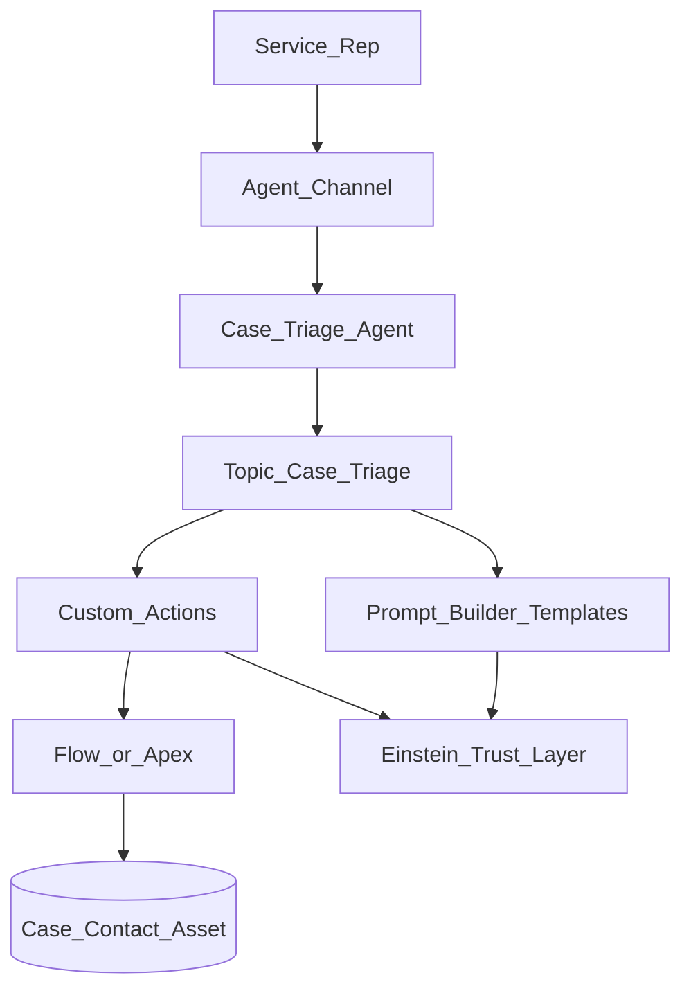

# Project A — Architecture

## Diagram

## Component notes (fill after build)

| Component | Name in org | Purpose |
| --- | --- | --- |
| Agent | | |
| Topic | | |
| Prompt: Summary | | |
| Prompt: Reply | | |
| Action: GetContext | Flow / Apex: | |
| Action: UpdateTriage | Flow / Apex: | |
| Action: CreateTask | Flow / Apex: | |

## Security context

- Running user / agent user: ____________________
- Object CRUD/FLS considered for: Case, Task, Contact, Asset
- Fields agent may update (whitelist): ____________________
- Fields agent must never update: ____________________

## Hybrid reasoning / deterministic controls

| Control | How I used it |
| --- | --- |
| Filters | |
| Variables | |
| Template expressions | |
| Instruction hard-stops | |

## Failure modes observed

1.
2.
3.

## Why not pure Flow?

> Flow alone cannot interpret messy natural language + multi-turn clarification. The agent uses Flow/Apex as **tools** for deterministic writes; the LLM handles understanding and drafting under guardrails.
