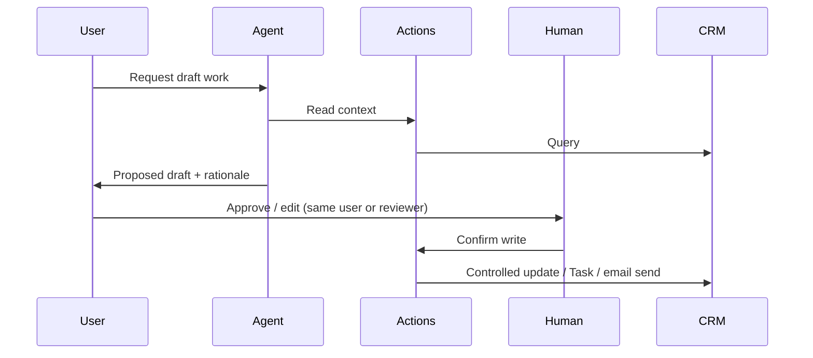

# Project B — Ops Co-pilot (Human-in-the-Loop)

## Problem

Ops / service / sales teams need faster drafts (updates, emails, next steps) without unsupervised automation writing to customers or critical fields.

## Pattern



## MVP scope

| Agent may do | Human must do |
| --- | --- |
| Read case/opportunity context | Approve customer-facing send |
| Draft email / chatter / task text | Approve Status/Stage changes |
| Suggest field values | Confirm irreversible actions |
| Create Task “Pending approval” | Final ownership of outcome |

## Topic design

1. **Draft_Work** — produce draft only
2. **Apply_Approved_Change** — only after explicit confirmation phrase (e.g. “approve and update”)

### Confirmation gate (instructions excerpt)

```
Never update Status, Stage, Amount, or send customer email unless the user
explicitly confirms with the phrase: APPROVE UPDATE.
If confirmation is missing, show the proposed change and ask for approval.
```

## Channel practice (pick one)

| Channel | Why use it | Notes from my build |
| --- | --- | --- |
| Slack | Where work already happens | |
| Experience Cloud | External users / partners | |
| Email | Async customer/service | |

My chosen channel: ____________________

Detailed notes: [channel-practice.md](channel-practice.md)

## Measurable outcome (define before build)

- Baseline time for one ops task: ______
- Target after co-pilot: ______
- Quality check: ______ % of drafts accepted with minor edits

## Acceptance tests

1. Draft without confirmation → no CRM write to protected fields
2. “APPROVE UPDATE” → allowed write occurs once
3. Out-of-policy request → refuse + Task for manager
4. Channel-specific: message formatting acceptable for chosen channel

## Demo script

1. Ask for draft next steps on a record.
2. Show proposal.
3. Attempt write without approval → blocked.
4. Approve → show controlled update / Task.
