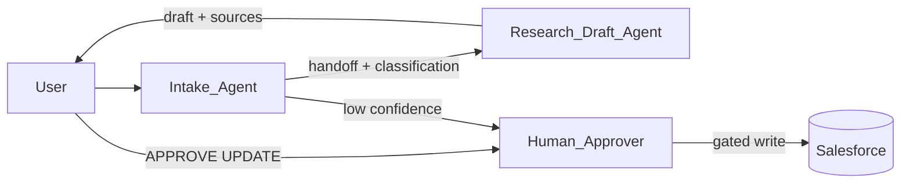

# Project D — Coordinated Agents (Interview Gold)

Small multi-agent portfolio piece: prove you know **when** to split agents and **how** they hand off — not a giant platform rewrite.

## Problem

A single mega-agent with every topic becomes hard to permission, test, and reason about. Split responsibilities:

1. **Intake Agent** — classify and route
2. **Research / Draft Agent** — grounded research + draft
3. **Human** — approve sensitive writes (reuse Project B gate)

Optional stretch: thin **Action Executor** topic/agent with strict write permissions only.

## Architecture

## Agent 1 — Intake & Classify

| Field | Design |
| --- | --- |
| Job | Parse request; classify intent; attach Case/Opportunity Id; decide route |
| May do | Read lightweight context; create “intake” Task; set classification fields (whitelist) |
| Must not | Customer send; refunds; broad updates |
| Outputs to handoff | `intent`, `priority_hint`, `recordId`, `confidence`, `notes` |

### Sample classification intents

- `knowledge_question` → Research agent
- `case_triage` → Research agent (or Project A agent)
- `policy_exception` → Human immediately
- `unclear` → Clarify with user

## Agent 2 — Research & Draft (grounded)

| Field | Design |
| --- | --- |
| Job | Retrieve grounded context; summarize; draft reply or next steps |
| May do | Call retriever / Get Context actions; produce draft only |
| Must not | Write protected fields without confirmation |
| Inputs from Intake | Classification payload + record Id |

## Shared actions & permissions

| Action | Used by | Permission posture |
| --- | --- | --- |
| Get Case/Opportunity Context | Intake, Research | Read |
| Knowledge / Data Library retriever | Research | Read |
| Create Task | Intake, Research | Create Task only |
| Update whitelisted fields | Human-gated path only | Narrow FLS |
| Send email | Never in MVP | — |

## Handoff rules

1. Intake confidence **below threshold** → ask clarifying question or escalate to human (no Research call).
2. Intent `policy_exception` → skip Research; create manager Task.
3. Research always returns: **draft + sources + open questions**.
4. Any CRM write to Status/Stage/Amount/email → require `APPROVE UPDATE` (Project B).

## Why multi-agent beat a monolith (one-pager)

Fill after your build; use this table in interviews.

| Dimension | Monolith (one fat agent) | Multi-agent (this design) | Winner for this use case |
| --- | --- | --- | --- |
| **Control** | One perm set does everything | Intake read-heavy; writes gated | Multi |
| **Testability** | Huge prompt surface | Smaller suites per agent | Multi |
| **Latency** | Single call may be enough | Extra handoff hop | Monolith (often) |
| **Cost** | One reasoning pass | Two passes when routed | Monolith (often) |
| **Change safety** | Any edit risks all topics | Isolate Knowledge vs Intake changes | Multi |

### Decision rule of thumb

> Use **one agent** when topics share the same permissions and test suite. Split when **trust boundaries**, **grounding corpora**, or **release cadence** differ.

## Acceptance tests

| # | Scenario | Expected |
| --- | --- | --- |
| 1 | Clear knowledge question | Intake → Research → grounded draft |
| 2 | Policy exception language | Intake → human Task; no auto-write |
| 3 | Vague utterance | Clarifying question; no silent route |
| 4 | Approve path | Write only after confirmation |
| 5 | Research miss | Refuse + escalate; no invented policy |

## Demo script (5 minutes)

1. Show Intake classification on a sample utterance.
2. Show handoff payload (even if documented).
3. Research returns grounded draft + source.
4. Attempt write without approval → blocked.
5. Explain latency/cost tradeoff vs control using the table above.

## Org implementation notes

| Field | Value |
| --- | --- |
| Pattern used | SOMA / topics-as-specialists / other |
| Intake agent name | |
| Research agent name | |
| Handoff mechanism | |
| Confidence threshold | |
